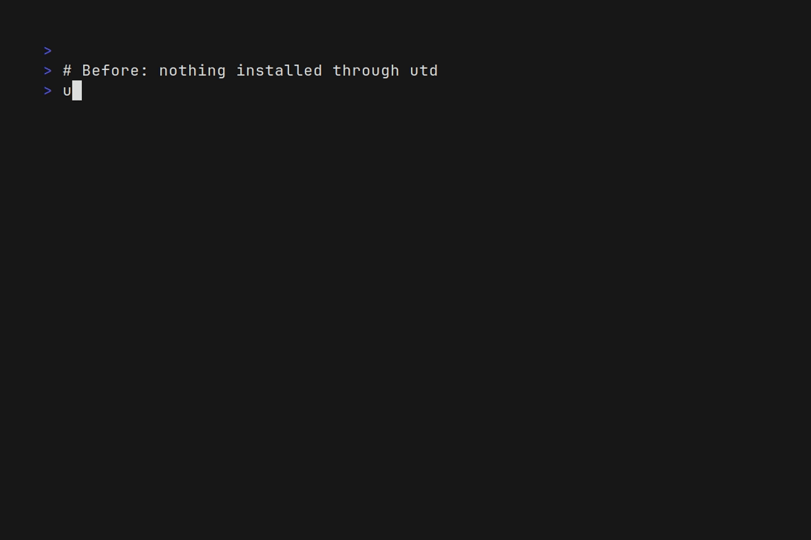

# utd — Use Then Delete



`utd` runs a command that is **not installed** on your system. It figures out
which distribution package provides that command, downloads the package *and
its missing dependencies* into a temporary directory, extracts them there and
runs the program from that private tree. **Nothing is installed system-wide**,
no `apt install`, no root, no leftover.

The downloaded files live under `/tmp/utd` by default, which your system wipes
on reboot — so they clean themselves up. If you want them gone immediately, run
with `--delete=now` and they are removed as soon as the command exits
successfully.

```
utd ffmpeg -i input.mp4 output.avi
utd --delete=now sl
utd figlet hello
utd nmap -p 22,80 192.168.1.1
```

## Why

Sometimes you need a tool exactly once: a quick conversion, a one-shot network
scan, a single `figlet` banner. Installing it pollutes your system, leaves
packages you will never use again, and drags in dependencies. `utd` gives you
the command now and makes it disappear later.

## How it works

1. **Is the command already there?** If it is in `PATH`, `utd` just runs it.
2. **Which package provides it?** `utd` resolves the command to a package using
   the apt indexes (see [Command resolution](#command-resolution)).
3. **What does it need?** `utd` asks apt's dependency solver which packages
   would have to be installed and downloads the ones that are missing.
4. **Download & extract.** The `.deb` files are fetched with
   `apt-get download` and extracted with `dpkg-deb -x` into
   `/tmp/utd/tree/<package>`. Nothing touches the real `/usr`.
5. **Run.** The extracted trees are put in front of `PATH` and
   `LD_LIBRARY_PATH`, and when [bubblewrap](https://github.com/containers/bubblewrap)
   is available they are additionally *overlaid* on the system directories, so
   programs that look for their data files through hard-coded paths (like
   `/usr/share/figlet`) find them too.
6. **Delete.** On reboot `/tmp` disappears. With `--delete=now` the packages
   used for the run are removed right after a successful exit.

## Installation

Build from source (Go 1.24+):

```sh
git clone https://github.com/Mathos6/utd 
cd utd
go build -o build/bin/utd_$(go env GOARCH) .
sudo install -m 0755 build/bin/utd_$(go env GOARCH) /usr/local/bin/utd
```

Or with `make`, which cross-compiles fully static binaries for `linux/amd64`
and `linux/arm64` into `build/bin/`:

```sh
make build        # -> build/bin/utd_amd64 and build/bin/utd_arm64
make install      # installs the host-architecture binary as $PREFIX/bin/utd
make checksums    # -> build/bin/SHA256SUMS
make help         # list every target
```

With the version embedded(the `make` targets do this automatically from
`git describe`):

```sh
go build -ldflags "-X main.version=$(git describe --tags 2>/dev/null || echo dev)" \
  -o build/bin/utd_$(go env GOARCH) .
```


`make build` sets `CGO_ENABLED=0`, so the produced binaries are statically
linked and have no libc dependency.

## Usage

```
utd [flags] <command> [args...]
```

The `utd` flags must come **before** the command name. Everything after the
command name is passed to the command untouched, flags included.

```sh
utd ffmpeg -i in.mp4 out.avi      # -i is ffmpeg's flag, not utd's
utd --delete=now ffmpeg -i in.mp4 out.avi
```

### Options

| Flag | Description |
| --- | --- |
| `-d, --delete <when>` | When to delete the downloaded packages: `now` (after a successful run), `reboot` (default, they live in `/tmp`), or `never` (persistent cache). |
| `-p, --package <name>` | Use this package instead of resolving it. |
| `--binary <name>` | Run this executable from the package (when it is not named like the command). |
| `--dir <path>` | Cache directory (default `$UTD_DIR` or `/tmp/utd`). |
| `-f, --force-download` | Download even if the command already exists locally. |
| `--no-deps` | Do not download the dependencies. |
| `--no-sandbox` | Do not use bubblewrap; rely on `PATH`/`LD_LIBRARY_PATH` only. |
| `-n, --dry-run` | Print what would be done, run nothing. |
| `-v, --verbose` | Explain every step. |
| `-q, --quiet` | Only report errors. |
| `--no-color` | Disable colored output. |
| `-V, --version` | Print the version. |
| `-h, --help` | Print help. |

Environment variables: `UTD_DIR` (default cache directory) and `NO_COLOR`
(disable colors).

### Subcommands

| Command | Description |
| --- | --- |
| `utd run <command> [args...]` | Explicit form of `utd <command>`. Use it when the command collides with a subcommand, e.g. `utd run list`. |
| `utd search <command>` | Show the packages that may provide a command, in resolution order. |
| `utd list` | List the packages currently in the cache with their size. |
| `utd clean [package...]` | Remove packages from the cache (`--all` removes the whole directory). |
| `utd version` | Print the version. |

## Command resolution

The hard part of "run a command without installing it" is that the command name
is often **not** the package name: `dig` is in `bind9-dnsutils`, `rg` is in
`ripgrep`, `bat` is in `bat` but the binary is `batcat`, and `nc` does not even
appear as a file because it is created by the alternatives system.

`utd` resolves commands by trying several sources, in order, and it *verifies*
each candidate by extracting the package and looking for the binary before
running anything:

1. `--package` / `--binary` if you provided them.
2. A small **built-in alias table** for well-known cases that cannot be
   discovered automatically (alternatives such as `nc` → `netcat-openbsd`
   (`nc.openbsd`), renamed binaries such as `bat` → `batcat`, `fd` → `fdfind`,
   or unrelated names such as `dig` → `bind9-dnsutils`).
3. A package with the **same name** as the command (`figlet`, `nmap`, `sl`).
4. The **apt `Contents` index** (`/var/lib/apt/lists/*_Contents-*`), which maps
   every file to its package. This is the authoritative answer to "which
   package ships `usr/bin/foo`?" and catches most renamed packages
   (`hexdump` → `bsdextrautils`, `ninja` → `ninja-build`, `pip` → `python3-pip`,
   `exiftool` → `libimage-exiftool-perl`, …).
5. The **`command-not-found` database** (a small SQLite file shipped by the
   `command-not-found` package), read through `python3`.
6. **`apt-file`**, when its cache has already been built.
7. `apt-cache search` as a last resort.

If a candidate turns out not to ship the requested binary, the next candidate
is tried. When the package ships the binary under a different name, `utd` also
matches it heuristically (normalizing `-`, `_`, case), which is how `figlet`
finds `figlet-figlet`.

Inspect the resolution without running anything:

```sh
$ utd search bat
SOURCE              PACKAGE            BINARY
utd alias           bat                batcat
apt Contents index  bacula-console-qt  bat
```

## Dependencies

`utd` never installs anything, so it has to download the dependencies itself.
It asks apt what *would* be installed:

```sh
apt-get -s -y --no-install-recommends install <package>
```

and parses the `Inst` lines. Dependencies that are already present on the
system are skipped entirely (there is no point in downloading a second copy of
`libc6`); only the missing ones are fetched, extracted into their own tree and
added to `PATH`/`LD_LIBRARY_PATH`/overlay. For example:

```sh
$ utd --dry-run nmap -V
utd: dry-run: package     : nmap (via package of the same name)
utd: dry-run: to download : nmap, liblinear4, nmap-common
```

`--no-deps` disables this and downloads only the main package.

## Deletion semantics

| `--delete` | Where packages go | When they disappear |
| --- | --- | --- |
| `now` | `/tmp/utd` | Immediately after a successful run. On failure they are kept so you can retry. |
| `reboot` (default) | `/tmp/utd` | On the next reboot, when the system clears `/tmp`. |
| `never` | `~/.cache/utd` | Never; the command is downloaded once and reused across reboots. |

Use `utd list` to see what is cached and `utd clean` to remove it now.

> `--dir` overrides the cache location. If you point `--delete=reboot` at a
> directory that is not under `/tmp`, the automatic reboot cleanup no longer
> applies; use `utd clean`.

## The sandbox (optional)

A `PATH`-based approach is enough for self-contained binaries, but many tools
look for their data through absolute paths compiled into the program
(`/usr/share/nmap`, `/usr/share/figlet`, …). When `bwrap` is installed and
usable, `utd` starts the command inside a private namespace where the extracted
trees are overlaid read-only on top of the real `/usr` (and `/opt`, `/lib`…).
Package content takes precedence, the rest of the system stays visible, and the
network stays available.

This is entirely optional: without bubblewrap `utd` falls back to injecting
`PATH`, `LD_LIBRARY_PATH` and `XDG_DATA_DIRS`. You can also force the fallback
with `--no-sandbox`.

## Requirements

- Linux, with a Debian-style package manager: `apt-get`, `apt-cache`,
  `dpkg-deb`, `dpkg-query`. This covers Debian, Ubuntu, Linux Mint, Kali, …
- `python3` to read the `command-not-found` database (optional, other resolvers
  are used otherwise).
- `bwrap` for the overlay sandbox (optional).
- The `Contents-*lz4` apt indexes and/or the `command-not-found` package make
  the renamed-package detection work automatically. Without them, `utd` still
  resolves same-named packages and the alias table, and you can always use
  `--package`.


## Limitations

- Non-Debian distributions are not supported yet. The code is written against a
  small `PackageManager` interface, so `dnf`/`pacman` backends can be added.
- Packages whose binaries load **kernel modules** or require setuid/root cannot
  be made to work from a temporary tree (`tcpdump` needs capabilities, some
  tools need a kernel module). `utd` runs them, but the kernel may refuse.
- Data files referenced through absolute paths need the bubblewrap sandbox to
  be usable.
- `utd` is not a security boundary: the command runs as you, sees your files and
  the network. It is a convenience tool, not a jail.

## Development

```sh
go build ./...
go test ./...
go vet ./...
```

The layout:

```
main.go                 entry point
cmd/                    cobra commands (root, run, clean, list, search, version)
internal/utd/
  options.go            configuration
  log.go                leveled logger
  cache.go              cache layout, index, PATH/LD_LIBRARY_PATH building
  apt.go                apt backend (download, deps, extract)
  providers.go          command->package providers (command-not-found, apt-file…)
  contents.go           apt Contents index reader (lz4/gzip)
  aliases.go            built-in alias table
  resolve.go            resolution order
  runner.go             the whole flow
  sandbox.go            optional bubblewrap overlay
  util.go               helpers
```

## License

MIT.
